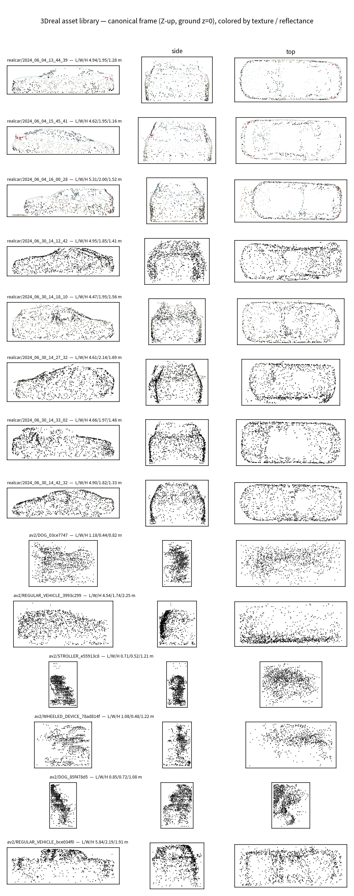

# 资产库：来源、规范化与质量门禁



*规范坐标系下的资产接触表（前视/侧视/俯视三视图，颜色 = 纹理/反射强度）：上 8 行为
3DRealCar 裁剪网格，下 6 行为 Argoverse2 轨迹点云。车顶空腔与半壳形态一目了然。*

## 来源

| 来源 | 形态 | 数量 | 说明 |
|---|---|---|---|
| 3DRealCar 裁剪资产 | `mesh.obj` + `mesh.jpg`(4096²) + `mesh.mtl` + `meta.json` | 199 套（A 档 158） | iPhone 扫描重建，车顶/玻璃系统性缺失；导出为 Y-up、绕 Y 轴约 45° 斜置 |
| Argoverse2 轨迹点云 | `<CAT>_<id>.npz`（pts/intensity/dims/ego/cat） | 24 条（7 类） | 稀疏半壳聚合，物体局部系、Z-up、bbox 居中；`_merged/manifest.json` 给逐 track 统计 |
| AV2 条件图 | `av2_assets/<scene>/view/<CAT>_<id>.png` | 部分 track | 832×704 RGBA，供 GPU 补全路线做单视图条件 |

## 规范化（`src/realinject/assets/normalize.py`）

统一规范坐标系 = `nusc-inject` 的 Blender 导入系：Z-up、落地 `z=0`、bbox min 归零、
X=车长 / Y=车宽 / Z=车高。

- **realcar**：UV 缝重复顶点合并（1 mm，34,754→31,879）→ 水平面 PCA 求 yaw 并对齐 +X
  （导出文件里车体斜置，AABB 虚胀为 3.82×4.60 m，真实 OBB 为 4.945×1.945 m）→
  Y-up→Z-up（`(x,y,z)→(x,-z,y)`）→ bbox min 平移归零。纹理必须直读 `mesh.jpg`
  （trimesh 对这套 obj/mtl 返回 2×2 占位材质）。
- **AV2**：点云已 Z-up、bbox 居中 → bbox min 平移归零；`dims`（box LWH）与点云
  extent 分开保存（位姿微调误差会让点云略超出框）。

## 质量门禁（`quality.py`）

realcar：仅 A 档；OBB 尺寸 L∈[3.5,6.5]、W∈[1.4,2.6]、H∈[1.0,2.0] m；纹理非退化
（std>5）；与清单 L/W/H 偏差 ≤20%（不一致记 `bbox_disagrees_*`）。
AV2：点数≥300、方位跨度≥90°、点密度≥150 点/m²、覆盖率≥0.01；DOG 且方位跨度≥200°
额外标记为**补全候选**（GPU 单视图 3D 生成路线）。

## 产物

`data/library/`（gitignored）：

```
canonical/realcar/<scene>.npz   # verts/faces/uv/normals/colors + raw_bbox
canonical/av2/<CAT>_<id>.npz    # xyz/intensity/ego/box_lwh
assets_manifest.json            # schema 3dreal-assets/1（唯一索引）
gates_report.json               # 逐资产门禁结论 + 拒绝原因直方图
```

## 复现

```bash
python scripts/build_asset_library.py            # 全量
python scripts/build_asset_library.py --limit 5  # 冒烟
```
