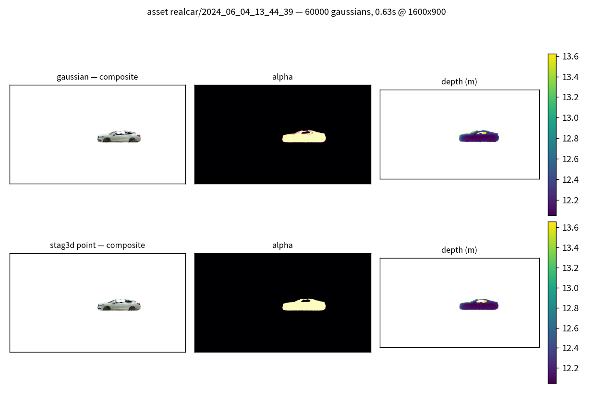

# 高斯渲染设计与实测

## 为什么用高斯

输入资产没有干净的封闭实体：realcar 网格缺车顶/玻璃，AV2 只有稀疏半壳点云。
3DGS 把两者统一成同一种表示（位置 + 各向异性尺度 + 旋转 + 不透明度 + 颜色），
渲染出 RGBA + 深度 + alpha，供合成与遮挡判定直接使用。

## 契约

```python
render(cam: CameraSpec, cloud: GaussianCloud, T_model2global, cfg) -> RenderOut
RenderOut(rgb uint8, alpha f32, depth f32[inf=empty], mask bool, info dict)
```

`CameraSpec` 与 `nusc-inject` 的 `camera_channel.build_job` 输出同构（name/K/
T_cam2global/width/height），相机系为 OpenCV（x 右、y 下、z 前，**不加** Blender 的
`diag(1,-1,-1)`）。`rgb` 是**非预乘**前景色，与 `composite_onto` 的
`blended = fg*α + bg*(1-α)` 约定一致。

## 算法：EWA 足迹 + 软 z 累积（`raster_cpu.py`）

1. 模型系高斯经 `T_cam2global⁻¹ · T_model2global` 变换到相机系；
2. 3D 协方差 `Σ = R diag(s²) Rᵀ`（四元数旋转 + 各向异性尺度）；
3. **EWA 投影**：`Σ2d = J Σ Jᵀ + 0.3·I`（J 为投影雅可比；0.3 px² 为官方 3DGS 的
   足迹膨胀项），足迹半径 `r = 3·√λmax(Σ2d)`（0.5–32 px 截断）；
4. 逐像素权重 `w = opacity·exp(-½ dᵀ Σ2d⁻¹ d)`；
5. **软 z 累积**（本实现与"前到后透射混合"的关键差异）：
   - pass 1：对 `w > 0.05` 的足迹对做逐像素 z-buffer 最小值 `zmin`；
   - pass 2：可见性 `vis = exp(-max(0, z - zmin)/τ)`，`τ = 0.1 m`；
   - 颜色 `Σ wv·c / Σ wv`（权重归一均值）、
     alpha `1 - exp(Σ log1p(-wv))`（独立透射积）、深度 `Σ wv·z / Σ wv`。

**为什么不用严格的前到后透射混合**：透射混合与顺序强相关，12 万高斯必须逐个
Python 循环（实测秒级/帧），且多相机批量注入时不可接受。软 z 形式把"遮挡"近似为
"离最近表面超过 τ 的层被指数抑制"——对不透明的表面采样资产（我们的全部输入）
误差 ≤ 0.1 m，且完全向量化（`bincount`/`lexsort`，C 级执行）。`τ` 是唯一的近似旋钮。

## 与 stag3d 点渲染的 parity（P2 验收）

`stag3d/renderer.py` 的点泼溅是既有 4D 演示的基准。高斯退化为微小不透明 splat
（σ=5 mm、opacity=0.999）后，两者必须在**点核**上逐项一致：

| 指标 | 门槛 | 实测 |
|---|---|---|
| 点核召回（ref 亮起的像素，我们的掩码也亮） | > 0.95 | 通过 |
| 光晕精度（我们的掩码 ⊆ ref 核 2 px 方形膨胀） | > 0.90 | 通过 |
| 核像素平均色差 | < 12/255 | 通过 |
| 核像素深度中位差 / p95 | < 0.01 m / 0.05 m | 通过 |

低 alpha 的足迹边缘像素允许与 1 px 点渲染存在归属差异（点渲染无法表达 3σ 光晕），
因此色深比较限定在 `alpha ≥ 0.5` 的核像素。测试：`tests/gauss/test_parity.py`
（需要 `../stag1_inject` 的 stag3d，缺失自动 skip）。



*同一资产（6 万高斯，1600×900，0.63 s）：上行高斯渲染、下行 stag3d 点渲染。
剪影、纹理色、深度一致；深度图中的暗斑即车顶/玻璃缺失（真实缺陷如实呈现）。*

## 性能实测

| 配置 | 耗时 |
|---|---|
| 120,000 高斯，1600×900（nuScenes 相机分辨率） | **1.13 s** |
| 60,000 高斯，1600×900 | 0.63 s |

足迹对数 ~520 万，全部在 numpy 向量化路径内完成；无 GPU 依赖。

## 后端

- **cpu（默认，本机可用）**：上述 EWA 软 z 光栅器（`raster_cpu.py`）。
- **gsplat（GPU 服务器）**：`raster_gpu.py` lazy import `gsplat`，接口完全相同，
  下游合成与扩散条件打包不感知后端；本机无 CUDA 时抛出带安装指引的 RuntimeError。

## 高斯初始化

- **网格**：面积加权表面采样；颜色 = 纹理 UV 双线性采样（经重心坐标插值）；
  尺度 = kNN 中位间距 × 0.8（3–150 mm 截断）；旋转 = 面法向（局部 +Z 对齐法向）。
- **点云**：尺度 = kNN 平均间距 × 1.2；颜色 = 反射强度灰度（或密度 turbo 色）；
  不透明度 0.85；旋转单位四元数。

## 与注入管线的关系

`gauss/<cam>.png`（RGBA 前景）与 `depth/<cam>_obj_depth.npy` 与上游 Blender 通道
产物目录语义一致，因此和谐化模块的掩码重建
`visible = (alpha>thr) & (obj_depth<=scene_depth+margin)` 保持逐位同义。
LiDAR 通道通过 `gauss/lidar_splat.py` 消费高斯中心（网格法向直取、点云 kNN PCA
估计并朝外定向）。
