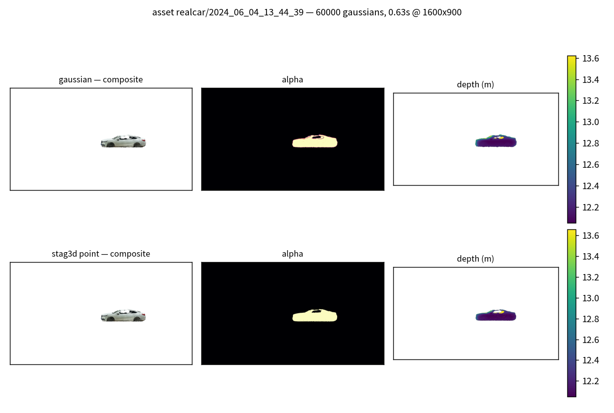

# 高斯渲染设计与实测

## 为什么用高斯

输入资产没有干净的封闭实体：realcar 网格缺车顶/玻璃，AV2 只有稀疏半壳点云。
3DGS 把两者统一成同一种表示（位置 + 各向异性尺度 + 旋转 + 不透明度 + 颜色），
渲染出 RGBA + 深度 + alpha，供合成与遮挡判定直接使用。

## 契约

```python
render(cam: CameraSpec, cloud: GaussianCloud, T_model2global, cfg) -> RenderOut
RenderOut(rgb uint8, alpha f32, depth f32[inf=empty], mask bool, info dict)
```

`CameraSpec` 与 `nusc-inject` 的 `camera_channel.build_job` 输出同构（name/K/
T_cam2global/width/height），相机系为 OpenCV（x 右、y 下、z 前，**不加** Blender 的
`diag(1,-1,-1)`）。`rgb` 是**非预乘**前景色，与 `composite_onto` 的
`blended = fg*α + bg*(1-α)` 约定一致。

## 算法：EWA 足迹 + 软 z 累积（`raster_cpu.py`）

1. 模型系高斯经 `T_cam2global⁻¹ · T_model2global` 变换到相机系；
2. 3D 协方差 `Σ = R diag(s²) Rᵀ`（四元数旋转 + 各向异性尺度）；
3. **EWA 投影**：`Σ2d = J Σ Jᵀ + 0.3·I`（J 为投影雅可比；0.3 px² 为官方 3DGS 的
   足迹膨胀项），足迹半径 `r = 3·√λmax(Σ2d)`（下限 `r_min`、上限 `r_max·ssaa`
   截断——像素上限随超采样倍数缩放，否则近距高斯在子像素分辨率下被误剔）；
4. 逐像素权重 `w = opacity·exp(-½ dᵀ Σ2d⁻¹ d)`，**采样点取像素中心
   `(gx+0.5, gy+0.5)`**（整数采样会把每个足迹平移半像素，产生系统性锯齿）；
5. **软 z 累积**（本实现与"前到后透射混合"的关键差异）：
   - pass 1：对 `w > 0.05` 的足迹对做逐像素 **前表面** 最小值
     `zmin = min(z - k·σz)`（`σz` 为高斯在视线方向的厚度，`k = z_thickness_k`）；
   - pass 2：可见性按**前表面对前表面**比较
     `vis = exp(-max(0, (z - k·σz) - zmin)/τ)`，`τ = 0.1 m`——定义 `zmin` 的
     高斯自身 gap 恒为 0（无自抑制），而曲面上相邻采样的 z 差被各自的厚度
     吸收，不再互相误杀（这曾是曲面/掠射面穿透空洞的来源）；
   - 颜色 `Σ wv·c / Σ wv`（权重归一均值）、
     alpha `1 - exp(Σ log1p(-wv))`（独立透射积）、深度 `Σ wv·z / Σ wv`。

**画质后处理**（`gaussian.render` 可配，输出契约不变）：

- **2×2 SSAA 超采样**（`ssaa: 2` 默认）：按 `ssaa×` 内参/分辨率光栅化，
  alpha 取子样本均值、rgb/depth 取 alpha 加权均值重建——消除边缘锯齿与
  单样本覆盖率噪声，同时给出诚实的覆盖率读数；
- **保边平滑**（`smooth_rgb`, σ=28/255 双边滤波）：压制表面颜色颗粒而
  保留纹理边缘；alpha **不平滑**（超采样已重建覆盖，任何足以见效的滤波
  都会压低真实不透明度）；
- **去散点**（`min_blob_px: 8`）：小于阈值的连通域直接剔除；
- 浮点边界统一 `nan_to_num` 防御，保证 uint8 输出无 NaN。

**为什么不用严格的前到后透射混合**：透射混合与顺序强相关，12 万高斯必须逐个
Python 循环（实测秒级/帧），且多相机批量注入时不可接受。软 z 形式把"遮挡"近似为
"离最近表面超过 τ 的层被指数抑制"——对不透明的表面采样资产（我们的全部输入）
误差 ≤ 0.1 m，且完全向量化（`bincount`/`lexsort`，C 级执行）。`τ` 是唯一的近似旋钮。

## 与 stag3d 点渲染的 parity（P2 验收）

`stag3d/renderer.py` 的点泼溅是既有 4D 演示的基准。高斯退化为微小不透明 splat
（σ=5 mm、opacity=0.999）后，两者必须在**点核**上逐项一致：

| 指标 | 门槛 | 实测 |
|---|---|---|
| 点核召回（ref 亮起的像素，我们的掩码也亮） | > 0.95 | 通过 |
| 光晕精度（我们的掩码 ⊆ ref 核 2 px 方形膨胀） | > 0.90 | 通过 |
| 核像素平均色差 | < 12/255 | 通过 |
| 核像素深度中位差 / p95 | < 0.01 m / 0.05 m | 通过 |

低 alpha 的足迹边缘像素允许与 1 px 点渲染存在归属差异（点渲染无法表达 3σ 光晕），
因此色深比较限定在 `alpha ≥ 0.5` 的核像素。测试：`tests/gauss/test_parity.py`
（需要 `../stag1_inject` 的 stag3d，缺失自动 skip）。



*同一资产（6 万高斯，1600×900，0.63 s）：上行高斯渲染、下行 stag3d 点渲染。
剪影、纹理色、深度一致；深度图中的暗斑即车顶/玻璃缺失（真实缺陷如实呈现）。*

## 性能实测（60,000 高斯，1600×900）

| 配置 | 耗时 | 说明 |
|---|---|---|
| 优化前 cpu（整数采样、无 SSAA） | 1.24 s | 基线 |
| 优化后 cpu（ssaa=2 + 后处理） | 4.90 s | 4× 子样本的预期开销，作无 CUDA 回退 |
| **gsplat（RTX 5090，ssaa=2）** | **1.77 s** | 默认后端 |

## 画质 A/B（`scripts/make_quality_ab.py`，合成车体，60k 高斯 @1600×900）

| 路径 | 内部空洞率 | 表面颗粒 | 边缘硬跳变 | 不透明占比 |
|---|---|---|---|---|
| 优化前 cpu | 1.61 % | 5.0 | 3.07 % | 84.1 % |
| 优化后 cpu | 1.44 % | 4.6 | 1.76 % | 81.1 % |
| **gsplat（默认）** | **0.03 %** | 5.1 | **0.00 %** | **97.7 %** |

（颗粒度量的地板来自资产本身的 ±25/255 反射率抖动；"不透明占比"下降是
诚实覆盖率读数的体现——旧单样本路径会在稀疏处撞出满值。）图：
`data/outputs/quality_ab/ab.png`。回归门槛见 `tests/gauss/test_quality.py`
（空洞 <1%、边缘带 graded >60%、硬跳变 <5%、双后端掩码 IoU >0.95）。

## 后端

- **gsplat（默认，本机 RTX 5090 可用）**：`raster_gpu.py` lazy import
  `gsplat`（1.5.x 批维 viewmat/K、`(C,H,W,4)` 输出、`opacities (N,)` 均已
  适配），精确前到后透射混合 + 共享的 SSAA/后处理/契约执行，接口与 cpu
  完全相同；无 CUDA/gsplat 时抛出带安装指引的 RuntimeError。
- **cpu（回退）**：上述 EWA 软 z 光栅器（`raster_cpu.py`），本机无 GPU 时
  管线自动回退，下游合成与扩散条件打包不感知后端。

## 高斯初始化

- **网格**：面积加权表面采样；颜色 = 纹理 UV 双线性采样（经重心坐标插值）；
  尺度 = kNN 中位间距 × 0.8（3–150 mm 截断）；旋转 = 面法向（局部 +Z 对齐法向）。
- **点云**：尺度 = kNN 平均间距 × 1.2；颜色 = 反射强度灰度（或密度 turbo 色）；
  不透明度 0.85；旋转单位四元数。

## 与注入管线的关系

`gauss/<cam>.png`（RGBA 前景）与 `depth/<cam>_obj_depth.npy` 与上游 Blender 通道
产物目录语义一致，因此和谐化模块的掩码重建
`visible = (alpha>thr) & (obj_depth<=scene_depth+margin)` 保持逐位同义。
LiDAR 通道通过 `gauss/lidar_splat.py` 消费高斯中心（网格法向直取、点云 kNN PCA
估计并朝外定向）。
