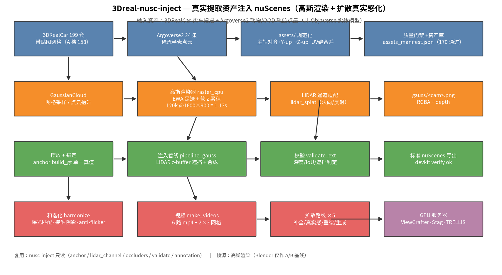
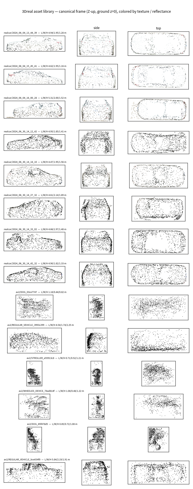
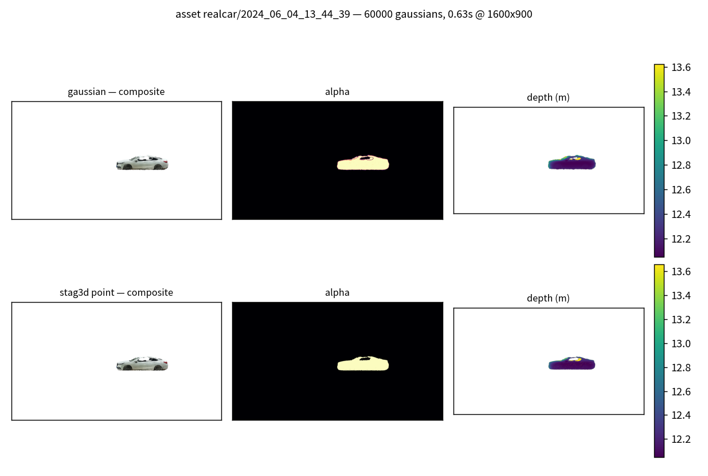
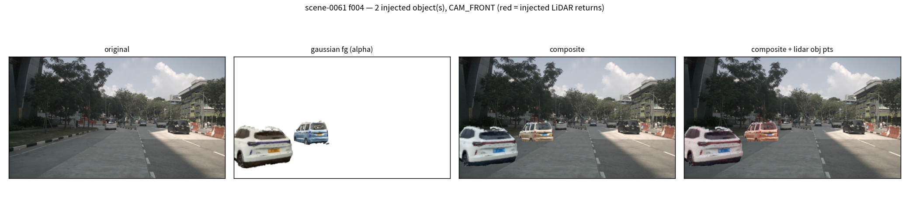
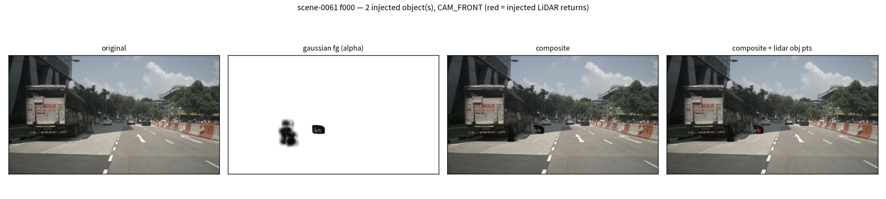
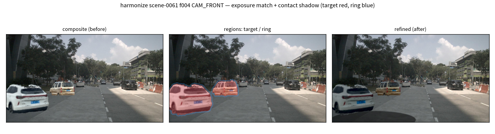
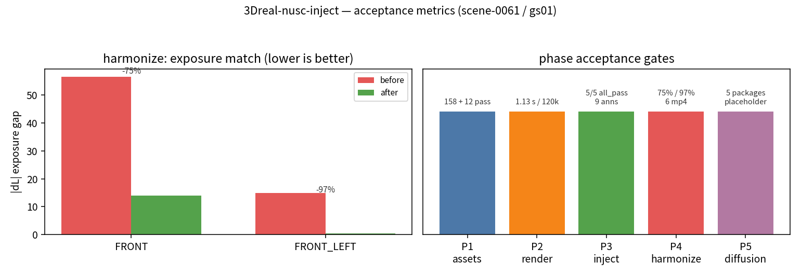

# 图文工作总结

3Dreal-nusc-inject：把**真实提取的 3D 资产**（3DRealCar 实车扫描 + Argoverse2 动物/OOD
轨迹点云）注入 nuScenes 的 LiDAR 与 6 路相机，产出标准注入数据集与照片级视频。
与上一代 `nusc-inject` 的区别：输入不是干净的 `.glb/.obj` 实体，而是**扫描网格（车顶
破洞）与稀疏半壳点云**，因此以**高斯泼溅（3DGS）**作统一表示与渲染器、以**扩散模型**
承担补全/真实感化/重绘/生成。

## 1. 总体架构

*资产 ingest → 高斯表示与渲染 → 注入（复用 nusc-inject 只读几何）→ 和谐化/视频 →
扩散路线（GPU）。帧源全程为高斯渲染，Blender 仅作 A/B 基线。*

## 2. 资产库（P1）

*规范坐标系（Z-up、落地 z=0）下的资产接触表：上 8 行 3DRealCar 裁剪网格（纹理着色）、
下 6 行 AV2 轨迹点云（反射强度着色）。车顶空腔与半壳形态一目了然。*

| 来源 | 形态 | 总数 | 通过门禁 |
|---|---|---|---|
| 3DRealCar | 带贴图 OBJ 网格 | 199 | **158**（A 档全通过） |
| Argoverse2 | 稀疏半壳点云 npz | 24 | **12**（7 类，DOG 补全候选 1） |

规范化要点：realcar 主轴 PCA 对齐（AABB 3.82×4.60 虚胀 → OBB **4.94×1.95**）、
UV 缝顶点合并（34,754→31,879）、纹理直读 `mesh.jpg`、Y-up→Z-up；AV2 bbox 归零、
box LWH 与点云 extent 分存。详见 [ASSETS.md](ASSETS.md)。

## 3. 高斯渲染（P2）

*同一资产（6 万高斯，1600×900，0.63 s）：上行高斯渲染、下行 stag3d 点渲染。
剪影、纹理色、深度一致；深度图暗斑即车顶/玻璃缺失（真实缺陷如实呈现）。*

- 算法：EWA 2D 协方差足迹 + **软 z 累积**（`bincount`/`lexsort` 全向量化，无逐高斯循环）
- 性能：**120,000 高斯 @1600×900 = 1.13 s**（预算 3 s）
- parity：点核召回 >0.95、光晕精度 >0.90、核像素色差 <12/255、深度中位差 <0.01 m

详见 [GAUSSIAN_RENDERING.md](GAUSSIAN_RENDERING.md)。

## 4. 注入与导出（P3）

*scene-0061 f004：原始帧 → 高斯前景（两辆 realcar 扫描资产）→ 合成 → 合成 + 注入
LiDAR 回波（红点落在目标上，跨模态一致）。*

- 5 帧全部 `validation all_pass=True`；导出 **9 条新标注 / 5 样本**，devkit `verify ok`
- 高斯深度 vs LiDAR 中位差 **~3 mm**；bbox IoU 0.80–0.92；遮挡判定 0 违例
- 复用：`anchor`（单一真值）/ `lidar_channel`（range-image 双向遮挡）/ `occluders` /
  `validate` / `annotation`（标准导出）——全部只读 import，上游零改动

**AV2 非车类注入演示**（`--assets av2/DOG_03ce7747,av2/STROLLER_e55913c8`）：

*scene-0061 f000：补全后的 DOG 闭合代理 + 原始半壳婴儿车注入；5 帧 all_pass，
10 条新标注，类别 `human.pedestrian.animal`（OOD 新类）+ `human.pedestrian.stroller`，
devkit verify ok。和谐化在 4 路相机上改善曝光（AV2 资产被更多相机拍到）。*

## 5. 和谐化与视频（P4）

*scene-0061 f004 CAM_FRONT：合成（前）→ 区域（红=目标、蓝=背景环）→ 精修（后）。
两遍法：pass A 逐帧 LAB 统计 + 时域平滑（anti-flicker）→ pass B 精修
（LAB 增益 + 接触阴影 + 边缘软化 + 噪声/锐化）。帧源 = 高斯渲染的 `gauss/<cam>.png`。
LAB 阶段现为 `lab_channels [L,a,b]` + `lab_weights {L:1, a:0.5, b:0.5}`——
只压 L 会在低亮度下把奶油色车漆压成橄榄色（f004 车体 B 通道 156→38），
a/b 半权重把颜色拉回「等比压暗」的物理预测附近（B→64），车漆质感调优即此项。*

| 批次 | 曝光 \|dL\| | 色度（a/b 半权重） | 闪烁降低 | dE(target,ring) |
|---|---|---|---|---|
| gs_e2e_tex（奶油涂装） | 135.4 → 16.6（**88%**） | gap 29.4 → 15.2 | 78% | 138.5 → **22.9** |
| gs_e2e（av2 灰车） | 58.2 → 7.0（**88%**） | gap 1.2 → 0.7 | 80% | 58.2 → **7.0** |

A/B 存档：`data/outputs/gs_e2e_tex_w30|w50`（权重 0.3 / 0.5 变体），
对比拼图 `gs_e2e_review/paint_ab/montage_f00{2,4}.png`。

视频：6 路相机 mp4 + `grid_2x3.mp4`，帧源三级回退 `refined → composite → 原图`。

## 6. 扩散路线（P5）

5 个 backend 全部出包（`prepare_diffusion.py --route all`），条件源契约强制追溯到
`/gauss/` 帧：

| 路线 | 作用 | 条件 | 权重 |
|---|---|---|---|
| A viewcrafter | 场景真实感化 | ref.png + traj.txt | ViewCrafter_25（旧机 22 GB） |
| B1 stagg_b1 | 官方 Stag 扩散核 | renderings.npy [25,576,1024,3]（高斯转台渲染） | model_sparse.ckpt |
| C sd_inpaint | 合成区重绘 | composite + visible mask | SD inpaint |
| D complete | 资产补全（AV2 半壳/车顶） | view.png + half_shell.npy | TRELLIS / Hunyuan3D-2 |
| E magicdrive | 生成式插入（占位） | specs.json bbox | MagicDrive（需训练） |

所有 `run_local` 返回 `placeholder`；GPU 服务器执行 `command.sh` 后 `collect()` 回填。
**路线 D 的 CPU 部分已实际跑批**（`complete_assets.py`：5 条 realcar fan_fill 补洞 +
5 条 av2 半壳镜像凸包闭合，az<200° 1 条按数值门跳过、0 失败；GPU 生成式
（TRELLIS / Hunyuan3D-2）仍待权重——本机 third_party 只有 ViewCrafter/stag）。
详见 [GPU_DIFFUSION.md](GPU_DIFFUSION.md)。

## 7. 验收指标总览

| 阶段 | 指标 | 结果 |
|---|---|---|
| P1 | realcar A 档 / AV2 通过 | **158 / 12**（223 条记录，170 通过） |
| P2 | 解析球 α 误差 / 渲染耗时 | <15% / **1.13 s**（120k @1600×900） |
| P3 | 注入 all_pass / 导出校验 | **5/5 帧** / **verify ok（9 条新标注）** |
| P4 | 和谐化 dE(target,ring) / 闪烁 / 视频 | **58.2→7.0**（gs_e2e）·**138.5→22.9**（gs_e2e_tex），闪烁 −78~80% / 6 mp4 + 网格 |
| P5 | 条件包 / CPU 补全跑批 | **5/5**（3 条 frame 路线 gauss 追溯通过）/ **10/13**（5 fan_fill + 5 闭合代理，0 失败） |
| 全程 | 测试 / 卫生门禁 | **105 测试全绿（2 skip）** / ruff·pyflakes·pytest·硬编码路径·docs 全绿 |

## 8. 已知限制与下一步

- **车顶/玻璃缺失**是 3DRealCar 扫描的固有缺陷：高斯深度图如实呈现；CPU fan_fill
  补洞已跑批（边界边大幅收敛，见 `completion_report.json`），GPU 生成式补面待权重。
- **AV2 半壳**：CPU 镜像 + 凸包闭合代理已跑批 5 条（原壳存 `shell_xyz`，密度
  150→496 点/m² 过门）；精细几何（"耳朵尾巴"级）仍依赖单视图 3D 生成（路线 D GPU）。
- **摆位先验**使注入物多在前视相机：back 相机走原图回退（物理正确）；需要后视注入时
  调 `objects` 的 lateral/forward 范围。
- **扩散真实感化**（A/B1/C）与 **MagicDrive 生成式插入**（E）待 GPU 服务器实跑；
  条件包与驱动已就绪（`scripts/gpu/`）。
- **4D 演示**（freeze-view/freeze-time/multi-view）待 stag3d 管线移植（P6 遗留）。
